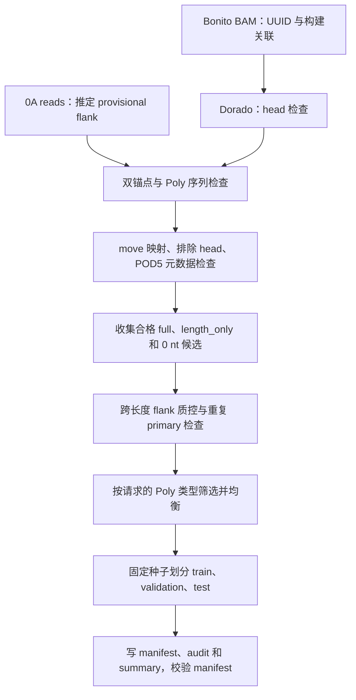

# 当前数据集制作方法：v3 polyA 弱监督开发集

> 2026-10-19：用户已确认构建为 head–Poly、没有 flank。本文保留为 v3 历史说明；
> 新数据使用 [v4 制作方法](prepare_dataset_v4.md)，不要沿用本文的 flank 解释。

更新日期：2026-10-14。

本文以当前代码为依据，说明固定长度构建数据如何转换为 Holypoly 训练 manifest。
当前使用方案是：**只选 polyA 正样本，保留 0 nt 负样本，每组目标上限为 6000 条，
达到配额后暂停边界与 POD5 元数据检查。** 脚本默认仍选 polyA 和 polyT，且默认
不开启配额暂停；上述方案由命令行明确指定。

数据集版本为 `construct-nominal-head-excluded-v3`。长度标签来自构建标称值，
定位边界来自 Dorado 序列、move table 和推定 flank，均属于弱监督证据。
本文用于开发验证；正式准确率评价仍需要可靠的逐 read 标签及独立验证设计。

## 1. 输入和输出

| 输入 | 用途 |
| --- | --- |
| Bonito save-ctc BAM | 通过 read UUID 关联构建，确定标称长度 |
| Dorado 比对 BAM | 提供 head 比对、序列、方向以及 `mv/ts/ns/fn` 标签 |
| 参考 FASTA | 整段序列作为 Poly 前的 head，名称中的 `<number>A` 表示标称长度 |
| POD5 | 检查 read 存在性及原始 sample 数，训练时读取信号 |

序列层面的构建结构示意为：

```text
head → Poly → provisional flank / 下游背景
```

原始输入位于只读 data root，输出位于外部 work root 的新目录。路径由 CLI、
环境变量或配置文件提供，优先级为 CLI > 环境变量 > local 配置 > 默认配置。
输入相对路径基于 data root，输出相对路径基于 work root。

制作结果包括 `manifest.tsv`、`audit.tsv` 和 `summary.json`。制作过程只读取
BAM、FASTA 和 POD5 元数据，不加载模型、不使用 GPU、不修改原文件，也不复制
signal 或生成 Bonito 原生训练所用的 `.npy` 文件。

## 2. 制作流程



### 2.1 第一阶段：关联 UUID 和构建

扫描 Bonito primary records。将 `UUID:chunk_index:chunk_count` 恢复为 UUID，
建立 UUID 到构建参考名称的关联；同一 UUID 分配到不同构建时拒绝并记录。
标称长度从参考名称解析。

Dorado read 通过 UUID 关联 Bonito，且两个 BAM 的构建参考名称必须一致。
secondary 和 supplementary records 不用于制作标签。

### 2.2 第二阶段：从 0A 推定 flank

从至多 200 条关联的 0A reads 中收集 head 后的候选序列，默认长度为 24 bases。
先检查 head 比对覆盖参考末端、最后 24 bases 至少 90% 匹配，且 head 最后一个
参考碱基有对应 query 碱基。

候选按替换距离聚合支持，默认误差率 0.1，即 24 bases 最多允许 2 个替换。
选择聚合支持最多的实际观察序列；同支持时再比较该序列自身出现次数，仍并列
则拒绝。默认至少需要 5 条支持。

这个结果是 **provisional flank**，并非独立验证的生物学锚点。匹配只容许
替换，不进行新的插入/缺失重比对。

### 2.3 第三阶段：检查边界和信号元数据

对关联的 Dorado primary record 依次执行：

1. 确认构建一致，并按上述规则检查 head 末端。
2. 在 head 后寻找唯一合格 flank。正长度要求两锚点间序列非空、A 比例至少
   80%，且连续非 A 不超过 2 个；0 nt 要求 head 与 flank 紧邻。
3. 使用 `mv` 的实际 stride 和 `ts`，将序列区间映射到原始未裁剪 signal samples。
4. 定义 head 后、move table 覆盖范围内的信号输入，检查区间大小和 head 边界。
5. 通过 `fn` 找到 POD5，用 UUID 查询 read 的 `num_samples`，核对信号长度。

BAM SEQ 按参考方向进行序列检查，因此反向比对也检查 A-rich 区域。映射回
原始测序方向时，forward 正样本标为 `polyA`，reverse 正样本标为 `polyT`。
0 nt 标为 `poly_type=none`，独立保留 `orientation`。

重复 Dorado primary 会使该 UUID 的已收集候选失效。缺 move 标签、split/duplex、
move/base 数不一致、非法坐标、POD5 read 缺失等情况均记录拒绝原因。
POD5 sample 数与 Dorado `ns` 仅允许以下末端差异：

```text
0 <= raw_signal_length - dorado_signal_samples < move_stride
```

### 2.4 跨长度 flank 质控

推定 flank 还必须在至少两个正标称长度中获得完整候选支持，总支持默认至少
5 条。质控证据仍可来自 polyA 和 polyT，即使最终训练只选 polyA。

若检查不通过，已有 full 正样本降为 length_only，0 nt 候选删除并记录原因。
这不会使数据自动获得可靠的逐 read 真值或生物学完整性证明。

## 3. 标签如何定义

所有保留样本使用以下长度关系：

```text
training_length_nt = nominal_length_nt
true_length_nt = training_length_nt  # 当前实现的兼容字段
label_source = construct_nominal_weak_supervision
```

| 样本 | 保留条件 | 标签及训练参与方式 |
| --- | --- | --- |
| full 正样本 | 双锚点、Poly 序列、move 和信号检查通过，跨长度 flank 质控通过 | 保留定位边界，长度用标称值，参与定位、长度及状态 loss |
| length_only 正样本 | 正构建无可靠 flank，但其余构建、head、move 和信号检查通过 | 只保留标称长度，定位和状态 loss 均忽略 |
| full 0 nt | head 与 flank 紧邻，信号检查和跨长度 flank 质控通过 | 长度为 0，有效定位标签全为 background，状态为 zero_nt |
| 标签制作失败 | 未满足保留条件 | 写入 audit，不自动变成 failure 训练样本 |

length_only 将 `poly_start_sample`、`poly_end_sample`、`poly_is_complete` 和
`observed_sequence_length_nt` 留空，保持未知。正构建漏检不被强制标成 0 nt；
0 nt 无可靠双锚点时也不能降级成 length_only。

full 的 `observed_sequence_length_nt` 是 head 与 flank 之间的 query bases 数，
包含允许的非 A 中断；它不替代长度回归目标。full 的 `poly_is_complete=true`
表示通过当前锚点检查，不表示单条 read 的完整性已经独立验证。

当前制作器没有生成 failure 训练样本。

## 4. 模型实际输入哪些信号

所有坐标采用原始 signal sample、0-based、左闭右开 `[start, end)`。
full 和 length_only 都保留 head 后的可见信号，其中可以包含 Poly、flank 和背景。
full 并非只截取已经标注的 Poly。

- forward 保留测序后端的对应区间，reverse 保留测序前端的对应区间，保持原始方向。
- 输入只覆盖 move table 可映射的范围，不借用 head 信号，也不扩展到未知信号。
- head 最后一个碱基与首个下游碱基共用 move block 时拒绝，避免混入 head 或切掉 Poly。
- 默认最大输入为 12000 samples；真实区间为空或超限时拒绝，不截断超限区间。
- manifest 只保存真实区间及 `model_input_samples`；训练时读取完整 read 的信号，
  按 reader 配置归一化，截取指定区间，再右侧补零到固定长度。
- padding mask 排除补零位置的定位 loss 和辅助头池化。

固定模型输入长度须为 12 的倍数，真实区间长度无需满足此条件。Dorado move
stride 用于制作 raw 坐标；Bonito v5 encoder stride 6 用于训练标签转换，两者
不能混为一谈。排除 head 的保证依赖接受的 Dorado 比对和 move 映射。

## 5. 筛选、均衡和 split

`--poly-types polyA` 只在最终均衡前排除 polyT 正样本，polyT 的稀缺数量不再
限制 polyA。0 nt 始终按独立组处理，该选项不筛选其方向，可能保留两方向负样本。
未指定时，脚本默认使用 `polyA polyT`；也支持只选 polyT。

正样本按“标称长度 × 请求的 Poly 类型”分组。至少有 3 条的组参与均衡，共同
数量为：

```text
q = min(per_group, 各受支持正样本组的合格候选数)
```

每个受支持正样本组采 q 条。0 nt 至多采 q 条，少于 q 不会降低正样本数量；
不足 3 条的组不保留。缺失或不足的请求组列入 `missing_positive_strata`。
`per_group` 是上限，不保证每组一定达到该值。

每组先按 UUID 排序，再以固定种子打乱；validation 和 test 各取
`max(1, 组数量 // 10)`，其余用于 train。一 read 一 chunk，不跨 split。
不按 full/length_only 比例均衡，也不按测序批次或生物样本独立划分。

例如，6 种正长度的 polyA 各采满 6000 条，0 nt 也采满 6000 条时：

| 项目 | 示例配额 |
| --- | ---: |
| 总 read/chunk 数 | 42000 |
| train | 33600 |
| validation | 4200 |
| test | 4200 |

这是配额示例，实际制作数量必须以输出 summary 为准。

## 6. 达到配额后如何暂停

`--stop-when-full` 默认关闭。开启后，只有所有请求的正长度/类型组达到 per_group、
参考中存在的 0 nt 组也达到 per_group，且跨长度 flank 质控通过时，才暂停昂贵的
边界、move 和 POD5 元数据检查。full 与 length_only 都计入正样本数量。

暂停后，剩余 BAM 仍扫描 primary UUID，避免遗漏文件后段的重复记录。重复导致
配额或 flank 支持不足时，恢复元数据收集，直到再次满足条件或到达扫描上限/EOF。
被跳过的 primary 标为 `not_evaluated_quota_met`，不表示质量检查失败。

某组一直不足或 flank 一直不通过时，这个选项不会提前暂停。第一阶段构建关联
仍按扫描上限执行，第二阶段仍至多收集 200 个 flank 候选；此优化主要减少
边界计算和 POD5 查询，不能保证减少 BAM 顺序读取量。

此模式的候选来自 BAM 顺序较前部分以及必要的恢复收集片段。随后虽然按种子
随机划分，仍可能受文件顺序影响，不能称为全数据均匀随机采样。去掉此选项
可恢复扫描范围内全部候选的采样；固定种子不能消除采样偏差。

## 7. 当前制作命令

从仓库根目录运行。data root 和 work root 由 `configs/local.yaml` 提供，也可
用相应 CLI 或环境变量指定。使用已存在的 Bonito 独立环境，不额外安装依赖。
输出目录必须尚不存在，且位于 work root 内、原始数据目录和代码仓库之外。

```bash
PYTHONPATH=src src/bonito/.venv/bin/python -m holypoly.datasets.prepare \
  --config configs/local.yaml \
  --bonito-bam basecalls/poly2p5per/basecalls.bam \
  --dorado-bam dorado_calls/poly2p5per/dorado_basecalls.bam \
  --pod5-dir pod5/poly2p5per \
  --reference fixed_len_ref.fa \
  --output-dir metadata/poly2p5per-head-free-v3-polyA-6000pergroup-quota \
  --max-records 0 \
  --per-group 6000 \
  --poly-types polyA \
  --stop-when-full
```

`--max-records 0` 允许各 BAM pass 读到 EOF，配额暂停并不跳过尾部 UUID 验证。
小规模检查可改为 `--max-records 10000 --per-group 3`，并更换新输出目录；两个
BAM 顺序不同，受限扫描缺少共同 UUID 不能证明整个数据集缺少样本。

| 参数 | 脚本默认值 | 当前命令值或含义 |
| --- | --- | --- |
| `--poly-types` | polyA polyT | polyA，保留 0 nt |
| `--per-group` | 1000 | 6000，是各组数量上限 |
| `--stop-when-full` | 关闭 | 开启，暂停元数据检查并继续 UUID 验证 |
| `--max-records` | 10000 | 0，允许扫描到 EOF |
| `--chunk-size-samples` | 12000 | 固定模型输入大小 |
| `--anchor-bases` | 24 | head 匹配窗口及 flank 候选长度 |
| `--anchor-error-rate` | 0.1 | 匹配允许的错误比例 |
| `--min-poly-fraction` | 0.8 | 正样本间隔的最小 A 比例 |
| `--min-flank-reads` | 5 | flank 的最小支持 |
| `--seed` | 20260923 | 均衡和 split 随机种子 |

脚本运行前打印 BAM 读取上限和资源提示。耗时、内存及输出量随 UUID 数、文件顺序、
存储速度和配额达成位置变化；配额暂停模式的真实提速尚未在本次文档整理中测量。

## 8. 制作后检查什么

| 输出 | 内容和检查重点 |
| --- | --- |
| `manifest.tsv` | 选中 read 的路径、坐标、长度来源、监督方式和 split；写后调用训练 manifest loader 校验 |
| `audit.tsv` | Bonito primary UUID 的选中、拒绝或未检查原因；标签制作失败不等于模型识别失败 |
| `summary.json` | 参数、输入、版本、时间、Git/Bonito commit、flank 支持和候选/选中数量 |

先确认 `arguments.poly_types`、`arguments.per_group` 和 `arguments.stop_when_full`
符合预期，然后检查以下字段：

- `selected_counts`、`supervision_counts`：实际分组、split 以及 full/length_only 数量。
- `eligible_counts`、`excluded_poly_type_counts`：实际检查过的合格候选及类型排除数量。
- `missing_positive_strata`：请求的分组是否缺失；主动排除的 polyT 不算缺失。
- `flank_status`、`flank_qc_reason`、`cross_length_flank_support`：锚点质控结果。
- `metadata_collection`：是否曾达到配额、最终配额是否满足、检查/跳过的记录数、
  恢复次数、候选统计范围、UUID 验证范围和采样策略。
- `head_excluded_reads`、`padded_reads`、`audit_counts`：输入策略和主要拒绝原因。

配额暂停后，候选及 flank 支持统计仅覆盖实际检查过的记录，不能据此推断全数据
的候选总量。结构校验通过也不证明信号边界正确，仍需小样本信号/序列联合审计。

数据质量检查优先关注：很短信号却赋予较长标称目标、观察长度与标称长度差异、
full 比例过低、0 nt 方向分布及文件顺序偏差。增加 polyA 数量不会自动修复弱标签，
也不保证增加 full 比例。只有 polyA 正样本监督的模型不能宣称已验证 polyT 能力。

训练前使用新数据对应的 manifest、checkpoint 和日志路径进行 dry-run，再开始
弱监督开发训练。训练、测试、续训和画图命令见 [common_commands.md](common_commands.md)。

## 9. 代码依据与验证范围

- 制作流程、坐标转换、采样和暂停规则：
  [prepare.py](../src/holypoly/datasets/prepare.py)。
- manifest schema、信号读取和 loss 标签 mask：
  [data.py](../src/holypoly/training/data.py)。
- 弱监督模式、配额暂停及尾部重复处理的合成测试：
  [test_prepare.py](../tests/isolated/datasets/test_prepare.py)。
- 补充运行和 integration 说明：[prepare_dataset.md](prepare_dataset.md)。

此前相关制作测试为 32 项通过，Ruff 和 mypy 通过，使用合成 BAM、POD5 元数据
替身与合成 manifest。它们验证代码行为，不证明真实数据标签质量。
本次只整理方法文档，没有重新制作数据、检查新一轮实际产物、运行真实模型或使用 GPU。
